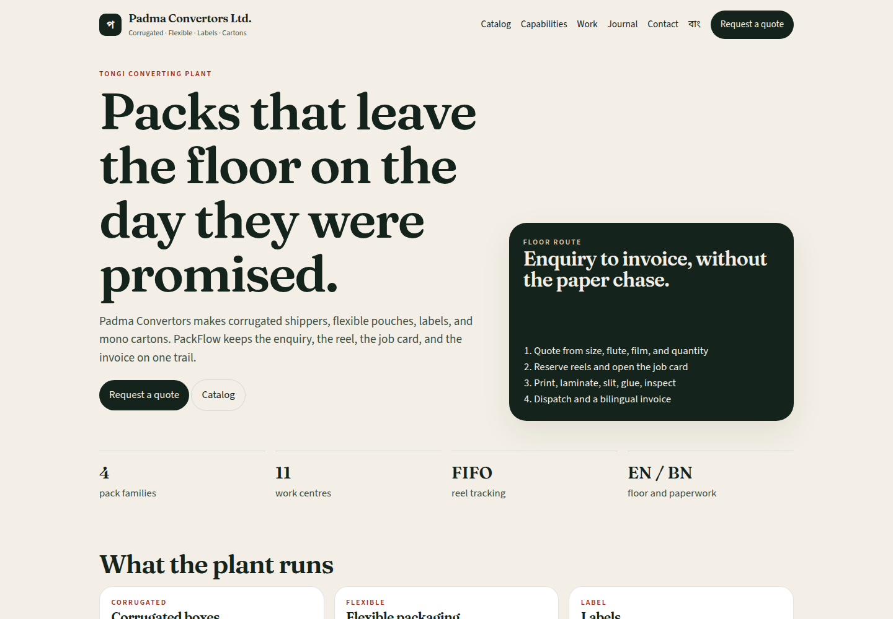
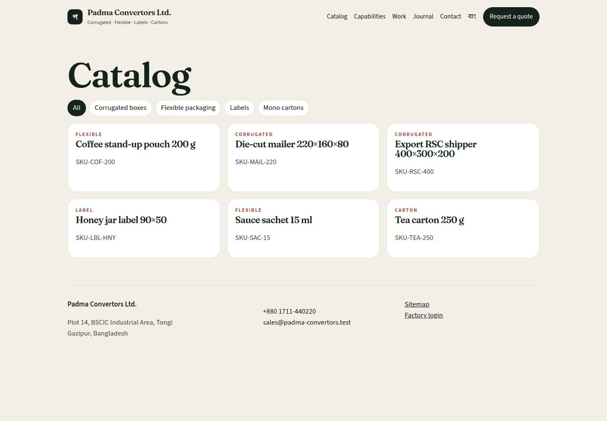
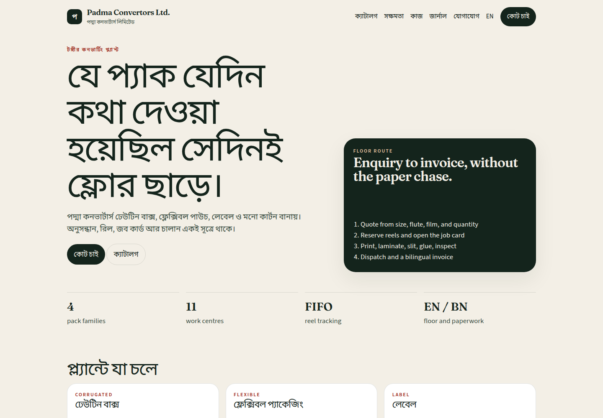
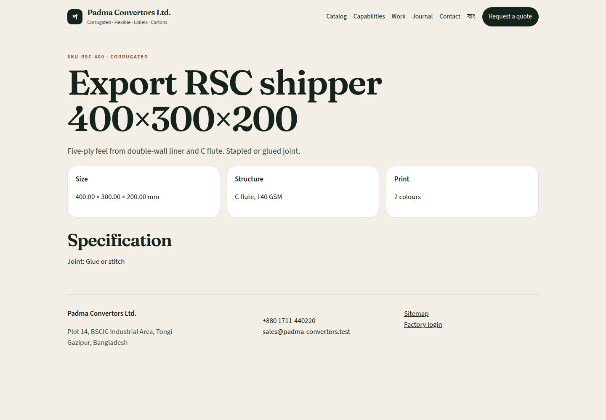
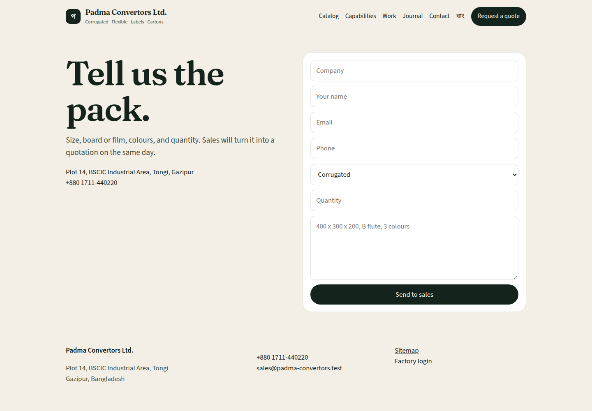
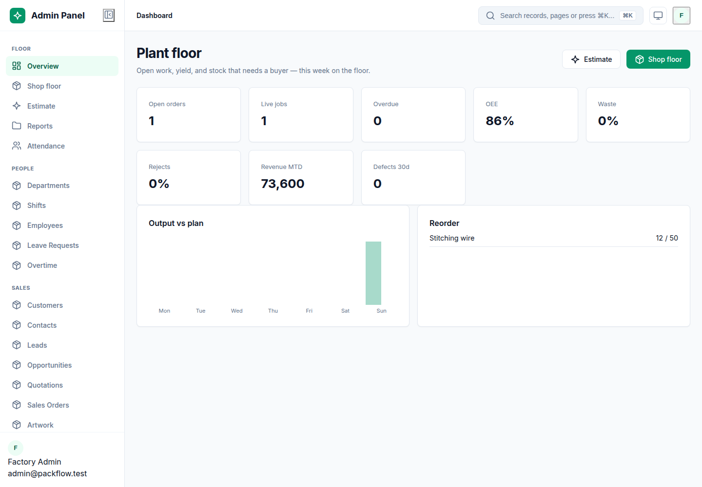
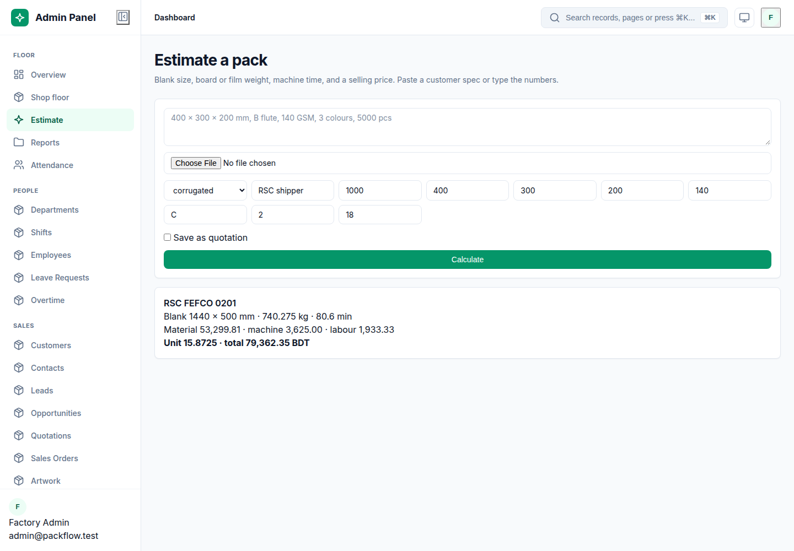
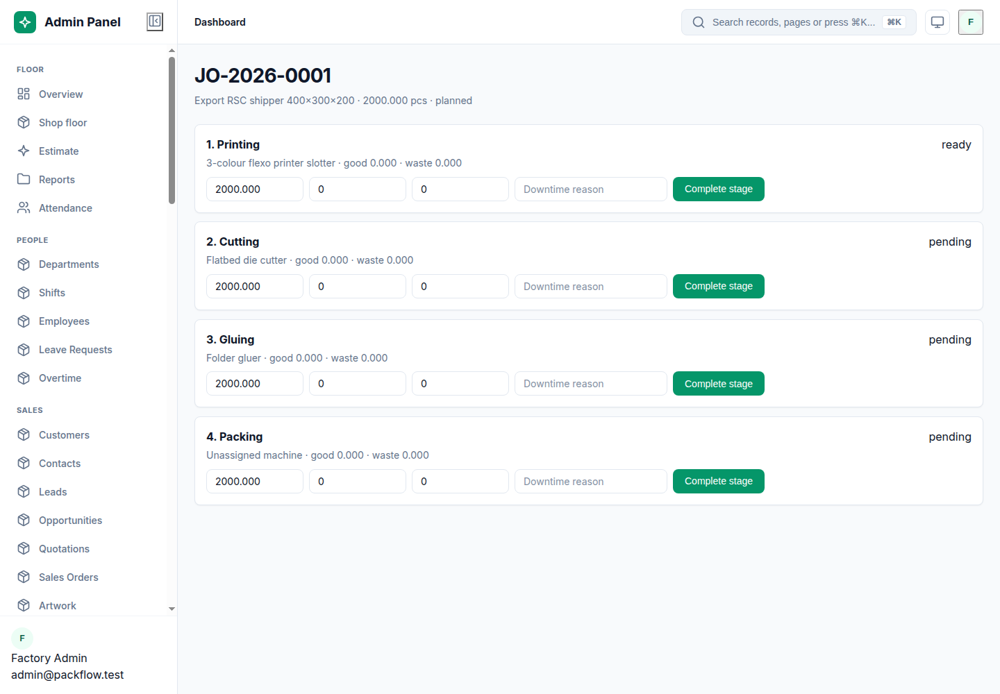
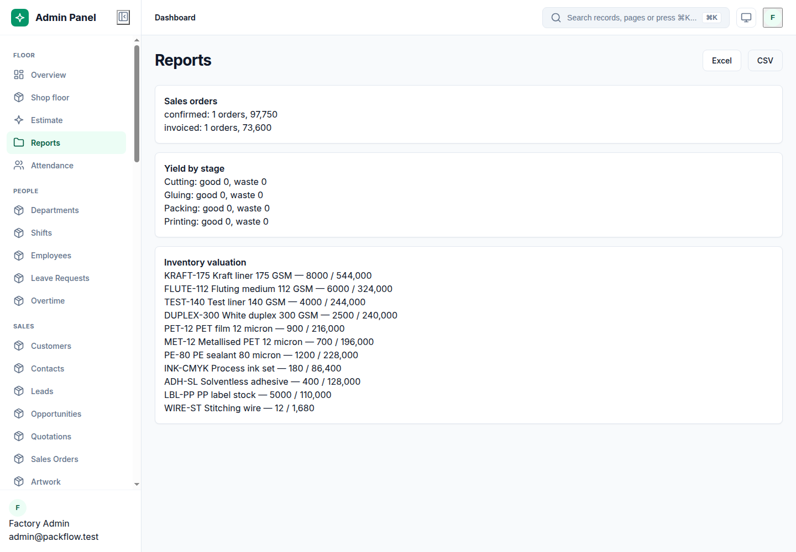

<p align="center">
  
</p>

<h1 align="center">PackFlow</h1>

<p align="center">
  The converting-plant system for corrugated boxes, flexible pouches, labels, and mono cartons.<br>
  Enquiry → estimate → order → reel → job card → QC → invoice. English and Bengali.
</p>

<p align="center">
  
  
  
  
</p>

The demo company is **Padma Convertors Ltd.**, a Tongi / Gazipur plant with a flexo, a die cutter, a folder-gluer, and a pouch line. Staff already know the sequence. PackFlow keeps that sequence and takes the copying out of it.

## Hours a paper office gets back

Take an ordinary week at a mid-size converter: about 15 new enquiries, 8 orders that the buyer confirms, and 8 dispatches. On job tickets and Excel, the office spends the week retyping. The presses do not get faster. The desks do.

| Work in that week | On paper | In PackFlow | Hours back |
| --- | --- | --- | --- |
| Price 15 new packs | About 45 minutes each with a flute chart and a private spreadsheet. **~11 hours.** | Paste the size, flute or film, GSM, colours, and quantity. **A few minutes each.** | About 10 hours |
| Turn 8 yeses into job cards and reserved reels | Copy the order, phone the store, write the ticket. **About half a day each, ~24 hours.** | Confirm the sales order. Lots reserve FIFO and the job opens with its stages. | About 20 hours |
| Hand those jobs to the next machine | The sheet is walked across the floor, or it sits. | Good quantity, waste, and downtime are recorded on the stage. The next desk is told. | The walking, and the lost sheet |
| Raise 8 invoices with VAT | Retype the order and work the tax. **About 25 minutes each, ~3 hours.** | Invoice from the order. The VAT journal and a Bengali-capable PDF come with it. | About 3 hours |
| Explain last week’s reject | Monday morning is spent asking who ran it. | The ticket is already on the job, the lot, the machine, and the operator. | The meeting starts with the answer |
| Notice a short reel | The machine stops. | A daily scan lists stock under the reorder line. The demo store already shows stitching wire at 12 kg against 50 kg. | The stop that did not happen |

**About 30 hours of clerical copying in a week like that**, before anyone counts the quote that used to wait until tomorrow or the complaint that used to live in a chat. A plant that already runs a tight ERP will save less. These figures are a worked example of a paper-run converting office, not a laboratory benchmark of this repository.

The same gap, one job at a time:

| The old habit | What usually happens on a paper floor | What PackFlow does |
| --- | --- | --- |
| Price a new RSC | 30–90 minutes. A new film structure takes longer. | “5,000 pcs of 400 × 300 × 200, B flute, 140 GSM, 3 colours” comes back as blank size, kilograms, minutes, and a BDT price. |
| Turn a yes into a job | Half a day. | One confirmation reserves lots, opens the job card, and lays the stages on the calendar. |
| Hand the job on | The sheet walks, or it sits. | The stage records good, waste, and downtime, then tells the next desk. |
| Invoice the dispatch | Accounts retypes the order. | The invoice, the VAT journal, and the PDF come from the sales order. |

## See the plant

The public site is the company’s face and the top of the sales funnel. A quote request becomes a CRM lead. The same pages read in Bangla.

<p align="center">
  
  
</p>
<p align="center">
  
  
</p>

Inside the factory the morning question is simple: what is open, what is late, what is short, and what did we make.

<p align="center">
  
</p>

Estimating uses the blank the die-maker already knows. For an RSC (FEFCO 0201) the sheet is `2 × (L + W) + joint` by `H + W`. Board weight is square metres × GSM × flute take-up × waste. The price in the picture is a real calculation from the demo rates.

<p align="center">
  
</p>

The shop floor is the job, one stage at a time. Good quantity, waste, and a downtime reason are recorded where the operator stands. Reports roll that up with the stock valuation.

<p align="center">
  
  
</p>

## Who it is for

- A corrugator that wants shippers, die-cuts, and mailers costed from flute, GSM, and quantity.
- A flexible-packaging line that specifies film as `12PET/12MET/80PE` and needs the GSM from micron and density.
- A label or mono-carton plant that wants the same order, stock, QC, and invoice trail.
- An owner who wants a public website that creates a lead, not a separate brochure site.
- A group that wants to switch a module off. A plant with no pouch line does not have to live with film recipes.

## The trail, end to end

```text
website quote
    → lead
    → estimate
    → quotation
    → sales order confirmed
    → BOM explosion and FIFO reservation
    → job card and schedule
    → print → laminate → slit → glue → finish → pack
    → inspection
    → finished goods
    → invoice, VAT journal, PDF
```

1. A visitor sends size, board or film, colours, and quantity. That row is a lead.
2. Sales prices it. They can paste the customer’s words, type the numbers, or drop a file for OCR when an AI key is configured. Saving the estimate opens a quotation.
3. Artwork approval sits on the order, so print does not start on a guess.
4. Confirming the order fires one event. Planning explodes the bill of materials, reserves the oldest lots first, and opens a job. If the product has no routing yet, the plant type supplies one: print, laminate, slit, glue, finish, pack. Fridays, Saturdays, and the local holiday list are skipped.
5. Similar jobs are grouped by pack type, flute, and colour count so a supervisor can cut changeovers.
6. The first stage issues the reserved material. The last stage receipts finished goods, opens the inspection checklist, and writes planned-against-actual job cost.
7. Finance raises the invoice once. The journal is debit accounts receivable, credit sales, credit VAT. The PDF uses a Bengali-capable font.

Document numbers (`QT`, `SO`, `JO`, `INV`, `PO`, `QC`, `MO`, `IS`, `JV`) come from a locked sequence and the year.

## What each module opens up

Every module can be turned off under **Admin → Modules**. A disabled module refuses its screens and its listeners. Confirming an order does not open a job if production is off.

### The company face

- Homepage, capabilities, services, portfolio, and a journal.
- Catalog filters for corrugated, flexible, labels, and mono cartons.
- Product pages with size, flute or film, GSM, and colours.
- Quote form that creates the lead sales will actually work.
- English and Bengali, a sitemap, canonical URLs, and JSON-LD.
- SEO slugs that survive a rename.

### The morning desk

- Open orders, live jobs, overdue work, a simplified OEE, waste, rejects, month-to-date revenue, and defects.
- Seven-day output against plan.
- Reorder lines for anything the store is about to run out of.

### Sales and estimating

- Leads, opportunities, quotations, sales orders, contacts, and artwork approval.
- Corrugated, flexible, label, and carton maths, including ink, machine time, labour, tooling, waste, and margin.
- Anomaly flags when the waste or the margin looks wrong for that pack.
- A customer portal where the buyer sees their own orders.

Flute take-up used by the estimator: A 1.53, B 1.36, C 1.46, E 1.27, F 1.22, BC 2.82, EB 2.63. Film GSM is micron × density (PET and MET 1.40, PE 0.92). Rates live in `config/packflow.php` and are priced in BDT for the demo.

### Product, specification, and the recipe

- Product master, variants, and a public or internal flag.
- Dimensions, flute, film structure, colours, and finishing.
- Bill of materials and the routing those materials follow.
- Recipes for films, coatings, and adhesives.
- Dies, plates, and cylinders, so tooling is not a drawer of unmarked wood.

### Store and purchasing

- Paper reels, films, inks, adhesives, and board, each with lot or reel, weight, and GSM.
- More than one warehouse and location. Raw, work in progress, and finished goods stay apart.
- FIFO reservation and issue. Movements and adjustments. Barcode text on the material so a later scanner has somewhere to land.
- Suppliers, requests for quotation, purchase orders, and goods receipt.
- A purchase suggestion when stock slips under the reorder level, and a simple view of whether a supplier delivers.

### Planning and the floor

- A job card for every confirmed line, tied back to the sales order.
- Work centres with a rate and an hourly capacity.
- A schedule that walks forward across working days.
- The material requirement, exploded from the BOM and reserved before the machine starts.
- Stage completion with operator, good quantity, waste, and why the machine stood.

### Quality, machines, and people

- In-process and final checks: burst, print, dimensions, adhesion, and whatever else the plant adds to the list.
- Defects and corrective actions, tied to a lot, a machine, and an operator.
- Customer complaints that do not disappear into a chat.
- Machine master, preventive plans, breakdown tickets, spare-part links, and downtime that feeds the OEE figure.
- Departments, shifts, leave, overtime, and attendance punches from the gate device.
- The operator on a stage is the same person as the employee record.

### Money and the argument after a bad job

- Planned against actual: material, labour, machine, waste.
- Invoices, payments, and a basic journal.
- PDFs for the invoice and the job card, including Bengali text.
- Production, waste, efficiency, stock valuation, and sales reports.
- Export to Excel and CSV. A Monday report email is scheduled for the accounts desk.

### When something goes wrong

- One ticket list for breakdowns, shortages, rejects, delays, and bad estimates.
- Escalation, and a knowledge base of ordinary converting problems: weak board, poor adhesion, a colour that will not hold, a reel that was issued to the wrong job.
- If an AI key is set, the same ticket asks for a root-cause note. If it is not set, the plant still gets the written answer from the knowledge base.

## The people, and what they are allowed to touch

| Desk | Email | What they open |
| --- | --- | --- |
| Super admin | admin@packflow.test | Every module that is switched on |
| Factory manager | manager@packflow.test | Every module that is switched on |
| Estimator | sales@packflow.test | Dashboard, CRM, catalog, website, issues, reports |
| Shift supervisor | supervisor@packflow.test | Planning, floor, quality, maintenance, stock, people |
| QC inspector | qc@packflow.test | Inspections, complaints, the floor, issues |
| Store keeper | warehouse@packflow.test | Stock, purchasing, issues |
| Accounts | finance@packflow.test | Invoices, costing, sales, purchasing, reports |
| Operator | operator@packflow.test | The job in front of them, issues, attendance |
| Buyer | customer@packflow.test | Their own orders on the portal. Not the admin. |

Every demo password is `password`.

## What runs without anyone clicking

- Order confirmed → job card, material reservation, and a note to the planner.
- Stage finished → the next stage is told, and stock moves.
- Every morning at 07:00 → stock under the reorder level becomes a purchase suggestion.
- Every morning at 06:30 → maintenance that is due, and machines that have broken down three times in thirty days.
- Monday at 08:00 → the weekly report email.

Mail uses whatever mailer you set. WhatsApp is a log channel plus an optional webhook (`PACKFLOW_WHATSAPP`). It is a place to connect a provider, not a live WhatsApp Business account.

Heavy work belongs on the queue: report exports and any AI call. Run `php artisan queue:work` next to `php artisan schedule:work`.

## Intelligence you can turn on

The plant runs with no API key. The estimator, the text parser, the diagnosis rules, and the catalog drafts are local.

| When you add a key | What it adds |
| --- | --- |
| AI Hub | A second opinion on an estimate, and a written diagnosis on a ticket |
| AI OCR | A customer order or spec file, in English or Bengali, pre-filling the quotation. Pasted text is parsed even with no key. |
| AI Catalog | Listing copy from a spec or a photo. A local English and Bengali draft is always kept. |

## Install

PHP 8.3 or newer, Composer 2, and SQLite, MySQL, or PostgreSQL. PHP needs `intl`, `mbstring`, `zip`, and the matching PDO driver.

```bash
composer install
cp .env.example .env
php artisan key:generate
touch database/database.sqlite
php artisan migrate
php artisan db:seed
php artisan serve
```

- Public site: `http://127.0.0.1:8000`
- Factory login: `http://127.0.0.1:8000/login`
- Admin: `http://127.0.0.1:8000/admin`
- Buyer portal: `http://127.0.0.1:8000/portal`

SQLite is the default. For MySQL or PostgreSQL, comment the SQLite lines in `.env` and uncomment the matching block from `.env.example`. Set `APP_TIMEZONE=Asia/Dhaka` if the plant keeps Bangladesh time.

```bash
php artisan test
```

The tests cover the RSC blank and board weight, film GSM, the plain-text spec parser, confirm → job → invoice, the public quote form, and a module that has been switched off.

## How the code is arranged

```text
app/Modules/Settings       company, tax, currency, modules, audit, sequences
app/Modules/Hr             departments, shifts, leave, overtime
app/Modules/Catalog        products, specs, BOM, recipes, tooling, routings
app/Modules/Inventory      warehouses, lots, FIFO, movements
app/Modules/Procurement    suppliers, RFQ, purchase orders, receipts
app/Modules/Crm            leads, estimates, quotations, orders
app/Modules/Production     planning, capacity, the job
app/Modules/Quality        inspections, defects, complaints
app/Modules/Maintenance    machines, plans, breakdowns, downtime
app/Modules/Finance        job cost, invoices, journals, PDFs
app/Modules/Issues         tickets and the knowledge base
app/Modules/Website        the public site
app/Modules/Dashboard      the morning numbers
app/Modules/Reports        Excel, CSV, and the Monday mail
```

Modules talk through events. `SalesOrderConfirmed` plans the job. `StageCompleted` tells the next stage. Policies guard confirming an order, running a job, and raising an invoice. A super admin passes those checks. Everyone else is limited by the role table in `config/packflow.php`.

## Packages in this plant

These `imrandevbd` packages are required. Several are published as `dev-main`, so Composer is set to `minimum-stability: dev` with `prefer-stable` on.

- **laravel-admin-panel** gives the emerald shell, the navigation, and the sign-in screen. This release has no resource classes of its own, so PackFlow registers every list on that shell.
- **laravel-ai-hub**, **laravel-ai-ocr**, and **laravel-ai-catalog** are the optional model calls. Each one has a local fallback.
- **laravel-attendance-hub** stores the gate device and the punches, shown under Attendance.
- **laravel-unicode-pdf** renders invoices and job cards, including Bengali.
- **laravel-universal-slug** keeps public and knowledge-base URLs stable.
- **tarikh** supplies the year on document numbers. Its published service provider is not in the package, so discovery is turned off and the date class is used directly. Weekends and the holiday list live in `FactoryCalendar`.
- **drutogoti** records requests and queries. It stays off until its tables exist, so the first `key:generate` does not fail. Events go to the queue. Run a worker if you want them stored. Tests turn it off.

## A sensible first week

1. Seed the demo, sign in as the admin, and walk one RSC from the estimate to the job card.
2. Replace the company name, tax, currency, and rates with the plant’s own.
3. Load real reels, real machines, and the BOMs you already trust.
4. Give sales, the store, QC, and the supervisor their own logins. Leave the operator on the shop floor only.
5. Turn off the modules this site does not run.
6. Point mail at the real server, then decide whether the AI key is worth it for OCR and ticket notes.

After that, the Monday meeting can start from the dashboard instead of from a stack of job tickets.
